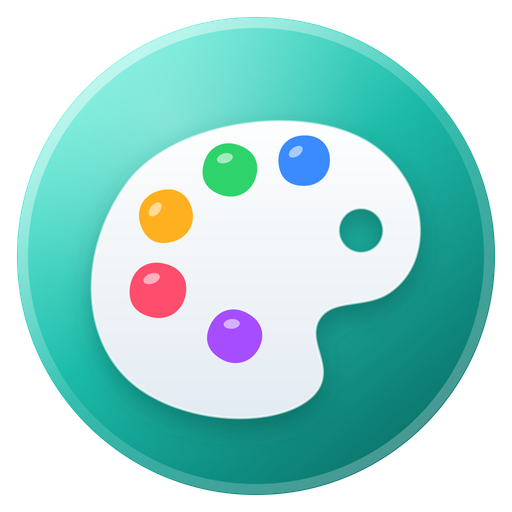

<p align="center"></p>

<h1 align="center">Quarc Draw</h1>
<p align="center">A professional layered <b>raster + vector drawing studio</b> — local-first, offline-capable, and syncable through the folder, server or WebDAV share you already trust.</p>

<p align="center"><i>By QuarcNet</i></p>

---

Quarc Draw is a single web app (TypeScript · React · Canvas 2D) that runs in any modern browser and installs as a desktop / tablet app (PWA). Think Photoshop · Krita · Procreate · Illustrator: pixel layers and vector layers side by side, pressure-sensitive brushes, selections, filters, adjustment layers, effects, masks, symmetry, text and bezier paths.

Notes and PDF reading live in their own Quarc apps (Quarc Notes, Quarc Reader); Quarc Draw is only for drawing.

The pictures on the home screen and in the About box — *Harbour at Dusk*, *Sunflowers* and *Campfire by the Lake*, a different one each time the app opens (swipe for another, tap to see it framed, full screen) — are oil paintings made **inside Quarc Draw** — a script drives the real app with pen events, so every stroke comes from its own Oil Bristle brush and layers (see [art/README.md](art/README.md); *Preferences* can hide them).

## Features

### Drawing & painting
- **Layers**: pixel, vector, group, and **adjustment layers**; 17 blend modes, opacity, clipping masks, alpha lock, raster **layer masks** (paint black/white), colour labels, drag-and-drop reordering, thumbnails
- **Non-destructive layer effects**: drop shadow, inner shadow, outer glow, stroke, colour overlay
- **Brush engine**: dab-based with pressure / tilt dynamics, stabiliser, spacing, scatter, jitter, angle-follows-stroke, procedural grain textures (paper / canvas / rough), wet colour mixing, image tips — **42 presets** (pencils, inks, markers, oil, acrylic, watercolour, charcoal, pastel, spray, stars, leaves, erasers…) plus a full settings editor and "save as brush"
- **Retouch tools**: smudge, blur, sharpen, dodge, burn, clone stamp
- **Selections**: rectangle, ellipse, lasso, polygon lasso, magic wand, selection brush; add / subtract / intersect, feather, grow, shrink, smooth, border, invert, save as mask, move the selection outline
- **Fill & gradient**: flood fill (tolerance, contiguous, expand, all-layers), linear / radial / angle / reflected / diamond gradients with an editor
- **Vector tools**: bezier pen, node editor, rectangle, ellipse, polygon, star, line, arrow, freeform; **boolean operations** (union / subtract / intersect / exclude), align & distribute, group, arrange, convert to path, stroke options (dash, caps, joins), gradient & pattern fills, shadows
- **Text**: in-place editing, any installed or imported font, weight / italic / underline / strike, alignment, leading, tracking, text boxes
- **Transform**: free transform with scale / rotate / flip, crop with aspect ratios, canvas & image size, rotate / flip canvas, trim
- **Filters** (live preview): Gaussian / box / motion / zoom / spin blur, unsharp mask, noise, median, emboss, find edges, pixelate, halftone, oil paint, glow, vignette, chromatic aberration, twirl, spherize, ripple, wave
- **Adjustments** (destructive *or* as editable layers): brightness/contrast, hue/saturation, levels (with histogram), **curves**, exposure, vibrance, colour balance, photo filter, gradient map, invert, B&W, sepia, threshold, posterize
- **Full-screen drawing**: just the canvas and one floating bar — brush, eraser, colour, size, undo, redo. In with the ⤢ button (title bar or the zoom pill) or `F`; out with **Exit**, `Esc`, `F` or the Back button. On Android it hides the system bars, on the desktop apps the window fills the screen
- **Drawing aids**: symmetry (vertical / horizontal / quadrant / radial), perspective guides, rulers with units (px / in / cm / mm / pt), draggable guides, grid + isometric grid, snapping to grid / guides / objects, pixel grid at high zoom, view rotation & flip
- **Colour**: HSV picker with alpha, harmony generator, 11 built-in palettes + your own, eyedropper (1–11 px averaging)

### Pages (artboards)
- Several pages per document with thumbnails and drag-to-reorder; single / vertical / horizontal / spread / grid / free layouts. Handy for comic pages, storyboards, sprite sheets — and **every page is a frame** when you export an animated GIF

### Files, import & export
| | Import | Export |
|---|---|---|
| Native project `.qdraw` | ✅ | ✅ (all layers, masks, vectors, assets, thumbnail) |
| PNG · JPEG · WebP · AVIF · BMP · GIF · ICO | ✅ | ✅ (scale, quality, transparency; animated GIF from pages; ICO multi-size) |
| SVG | ✅ editable vectors (paths, arcs, gradients, CSS, transforms, text) | ✅ |
| PDF | — | ✅ one page per artboard |
| PSD | ✅ layers, groups, blend modes | ✅ layered |
| OpenRaster `.ora` (Krita / GIMP) | ✅ | ✅ |
| Clipboard images, drag & drop, fonts (`ttf/otf/woff`), print | ✅ | ✅ copy PNG, share, print |

Per-layer export, selection-only export and 1×–6× scaling are built in.

### Library & sync
- **Documents library**: folders, tags, favourites, search, sort, trash, thumbnails, autosave to IndexedDB (works offline)
- **Sync** is local-first and conflict-safe (per-document revisions; if both sides changed, **both versions are kept**; deletions propagate; remote deletions go to the trash). Pick a provider in *File ▸ Sync settings*:
  - **Folder** — any folder kept in sync by a desktop client (Proton Drive, Dropbox, OneDrive, Google Drive, Syncthing…) using the File System Access API (Chromium browsers)
  - **Quarc account** — your Quarc server (see [Quarc account and server](#quarc-account-and-server)): sign in with the same account as the other Quarc apps (or via Quarc Store); per-account storage, optimistic concurrency, live push (SSE)
  - **WebDAV** — Nextcloud, ownCloud, any WebDAV share
  - **Dropbox** — via an access token

## Run it

```bash
cd frontend
npm install
npm run dev          # http://localhost:5173
```

Drawing needs nothing else. To try syncing too, start the server in a second terminal — a **development login** stands in for the Quarc login service:

```bash
cd frontend
npm run server       # = cd ../backend && node src/index.mjs --dev-auth  (port 3009)
```

Then *File ▸ Sync settings ▸ Quarc account* and sign in with any username and the password `dev`. Vite forwards `/api` to the server.

Production build / preview:

```bash
cd frontend
npm run build        # type-checks, then bundles to dist/
npm run preview      # http://localhost:4173
```

Install it as an app from the browser's address bar (Chrome / Edge: *Install Quarc Draw*) for full keyboard-shortcut support — browsers reserve `Ctrl+N/T/W` inside normal tabs.

## Quarc account and server

Documents belong to a **Quarc account** — the same account as Quarc Music, Notes and the other Quarc apps, and the same login: signing in to [Quarc Store](https://github.com/zekicandemiralay/Quarc_Store) on a device signs Quarc Draw in too (Android and Windows). **Drawing never needs an account**; signing in only turns on syncing (it switches on by itself the first time, unless you chose *Off*).

`backend/` is a small zero-dependency Node server (`backend/src/index.mjs`). It checks the shared login — the signed `token` cookie that quarc-auth issues and every Quarc app verifies locally with the same `JWT_SECRET` — and stores each account's documents under its account id. Behind nginx, `/api/auth/*` goes to quarc-auth and everything else under `/api/` to this server.

```bash
cd backend
JWT_SECRET=… node src/index.mjs                 # :3009
node src/index.mjs --static ../frontend/dist    # also serve the built app (handy without nginx)
node src/index.mjs --dev-auth                   # development only: fake login, password "dev"
npm test                                        # 12 tests: login, accounts, revisions, CORS, live updates, size limit…
```

| Environment | |
|---|---|
| `JWT_SECRET` | the same secret as quarc-auth and every other Quarc app (required, except with `--dev-auth`) |
| `SECURE_COOKIE` | `true` when served over HTTPS; must match quarc-auth (it decides the flags of a renewed login cookie) |
| `PORT` | default `3009` |
| `QUARC_DATA` | data directory (`users/<hash>/docs/*.qdraw` + `index.json`) |
| `QUARC_MAX_MB` | largest document, default `512` (nginx accepts up to 640) |
| `QUARC_ORIGINS` | extra browser origins allowed to call the API with the login cookie. Always allowed: any port on the server's own host name, `https://localhost` / `capacitor://localhost` (Android app) and `http(s)://tauri.localhost` (Windows app) |

API (all need the login): `GET /api/ping`, `GET /api/docs`, `GET|PUT|DELETE /api/docs/:id` (`PUT` sends the raw `.qdraw`; `X-Base-Rev` makes it conditional and a stale one answers `409 {rev}`), `GET /api/events` (server-sent `change` events, one stream per open device). `GET /api/health` needs no login.

## Apps

| | |
|---|---|
| **Web / PWA** | `https://quarcnet0.tail84500c.ts.net:4009` — installable from the browser |
| **Windows, macOS, Linux** | `desktop/` — a Tauri app that carries its own copy of the page, so it opens and draws without the server (`VITE_API_URL` is baked in for signing in and syncing). Opens maximized. The Windows installer (`*_x64-setup.exe`) is what Quarc Store installs |
| **Android** | `mobile/` — a Capacitor app, package `com.quarc.draw`, signed with its own key. Files are saved through the share sheet (a WebView cannot download a blob) |

Install and update the apps from **Quarc Store**; the GitHub release also has every installer. See [desktop/BUILD.md](desktop/BUILD.md) for building them yourself and [README_Users.md](README_Users.md) for a short guide.

## Deploy on the Quarc server (first time)

Same recipe as every Quarc app: Docker, nginx with the Tailscale certificate, the shared `quarcnet-shared` network (quarc-auth must be running). The app is on port **4009**.

```bash
cd ~ && git clone https://github.com/zekicandemiralay/Quarc_Draw.git && cd Quarc_Draw
cp ~/Quarc_Reader/.env .env      # the JWT_SECRET and SECURE_COOKIE every Quarc app shares
bash deploy.sh                   # builds and starts backend + frontend
bash check.sh                    # full diagnostic
```

Later updates: `bash deploy.sh` (or `deploy.sh frontend` / `deploy.sh backend`). `bash backup.sh` copies every account's documents and `.env`; `bash restore.sh <backup-dir>` puts them back. To list the app in Quarc Store, redeploy the Store's backend (`cd ~/Quarc_Store && bash deploy.sh store`): the catalog entry reaches existing servers by itself.

## Release

Tag `vX.Y.Z` and push the tag: GitHub Actions builds the Windows, macOS and Linux installers and the signed Android APK, and publishes the release. The Android signing key (`mobile/quarc-draw.keystore`, alias `quarc-draw`) and its password are **not** in git — keep a copy somewhere safe: without that key an installed app can never be updated. `versionCode = MAJOR*10000 + MINOR*100 + PATCH`.

## Keyboard & input

`Ctrl+K` command palette · `F1` all shortcuts (rebindable) · `V` move · `B` brush · `E` eraser · `M` marquee · `L` lasso · `W` wand · `G` bucket · `P` pen · `T` text · `I` eyedropper · `Space`-drag pan · `[` `]` brush size · `X` swap colours · `Ctrl+Z / Ctrl+Shift+Z` undo / redo · `Ctrl+T` free transform · `Ctrl+Shift+E` export · `Shift+R` back to upright · `F` full-screen drawing (`Esc` leaves) · `F11` full screen with all tools.
Touch & pen: pinch to zoom; twist with two fingers to rotate (only a deliberate twist turns the view, and it clicks into place at upright and at quarter turns — the pill on the canvas or `Shift+R` turns it back); two-finger tap = undo, three-finger tap = redo, optional **pen-only** mode and **palm rejection**, pressure curve in *Preferences*. New drawings can be Landscape or Portrait; *Image ▸ Rotate 90°* turns an existing one.

## Project layout

```
frontend/            the web app (TypeScript · React · Canvas 2D)
  src/
    core/            document model, renderer (blend / masks / clipping / effects), selection, history, vector geometry, viewport
    brush/           brush engine + presets
    filters/         pure pixel algorithms + filter registry (unit-tested)
    editor/          Editor controller + layer / page / object / raster operations
    tools/           every tool (brush, selection, transform, vector, text, crop…)
    io/              .qdraw, SVG, PSD, ORA, exporters, importers
    sync/            engine + providers (Quarc account, folder, WebDAV, Dropbox)
    app/             commands, preferences, storage (IndexedDB), workspace, the Quarc account
    lib/             API address, Quarc Store sign-in kit
    ui/              React shell, panels, dialogs
  tests/             unit (Vitest) + end-to-end (Playwright driving Edge / Chrome)
backend/             zero-dependency sync server (Quarc login, per-account documents) + tests
desktop/             Tauri app for Windows, macOS, Linux
mobile/              Capacitor app for Android
docker-compose.yml   backend + nginx frontend (port 4009) · deploy.sh, check.sh, backup.sh, restore.sh
```

Design notes: vector objects are immutable and raster surfaces are shared by reference, so undo snapshots are just shallow copies of the layer tree (cheap even for large documents); raster edits are recorded as before/after patches of the dirty rectangle; the same renderer draws the screen, the thumbnails and every exporter.

## Tests

```bash
cd backend && npm test                       # 12 tests: the Quarc login, accounts, revisions, CORS, live updates
cd frontend
npm run typecheck
npm test                                     # 36 unit tests (geometry, colour, filters, selection, flood fill, history, SVG paths, transform box, view rotation…)
npm run build && npm run test:e2e            # browser end-to-end suite (needs Edge or Chrome installed)
```

The e2e suite drives the production build and starts the real backend (with the development login): painting with every brush preset, layers & masks, selections, vector tools, text, filters, incremental repainting checked pixel for pixel against a full repaint, round-tripping every file format, two-device sync with conflicts, deletions, sign-in and sign-out (against the real server and a mock WebDAV server), pixel-level checks of blend modes, clipping, adjustment layers and effects, and more.
Run a single group: `node tests/e2e/run.mjs render` (`studio`, `io`, `sync`, `render`, `ui`). Screenshots land in `frontend/tests/e2e/out/`.

## Performance

Drawing stays fluent on large canvases and slow devices because a stroke only does the work its pixels need:

- while a stroke is painted, only the small area it touched is composited and repainted — not every layer of the whole view — and once a stroke has been going for a few frames the layers under it are rendered once into a cache;
- the stroke's two page-sized canvases are kept for the next stroke on the same layer, so consecutive strokes start instantly;
- undo patches hold only the tiles a stroke touched, kept as canvases (no pixel read-back from the graphics card), and the "redo" half is captured the first time you undo;
- the status bar is not updated while you draw, and autosave waits for a pause.

`cd frontend && npm run build && npm run perf` measures the frames per second of a pen stroke on a large canvas with many layers (a throttled CPU and a 2× screen stand in for a tablet): see `tests/e2e/perf-fps.mjs` for the options.

## Known limitations

Being upfront about what is *not* (yet) here:

- Colour is sRGB only — no CMYK / ICC profiles, no 16-bit or HDR canvases.
- No liquify / mesh-warp, no animation timeline (pages can be exported as an animated GIF "flipbook").
- No real-time multi-user co-editing (sync is per document with conflict copies).
- PSD export rasterises text / vector layers and skips adjustment layers; SVG import ignores filters, masks and clip-paths; PDF export embeds each page as an image.
- Folder sync needs a Chromium-based browser or the Windows app (File System Access API); it is not available on Android.
- The Mac and Linux apps are built but only the Windows and Android apps are tested by the author; "Save as" there uses the system's native dialog.
- Opening a `.qdraw` by double-clicking it in the file manager is not wired up yet (use File ▸ Open, or drag a file onto the window).
- Very large canvases (≥ 8000 px) are limited by browser memory; each pixel layer costs width × height × 4 bytes.

## Privacy

Everything stays on your device unless you sign in or configure sync. With a Quarc account the login is an httpOnly cookie the page cannot read; WebDAV and Dropbox credentials are stored in the browser's local storage on that device. Apart from sync, the app makes no network requests of its own.
